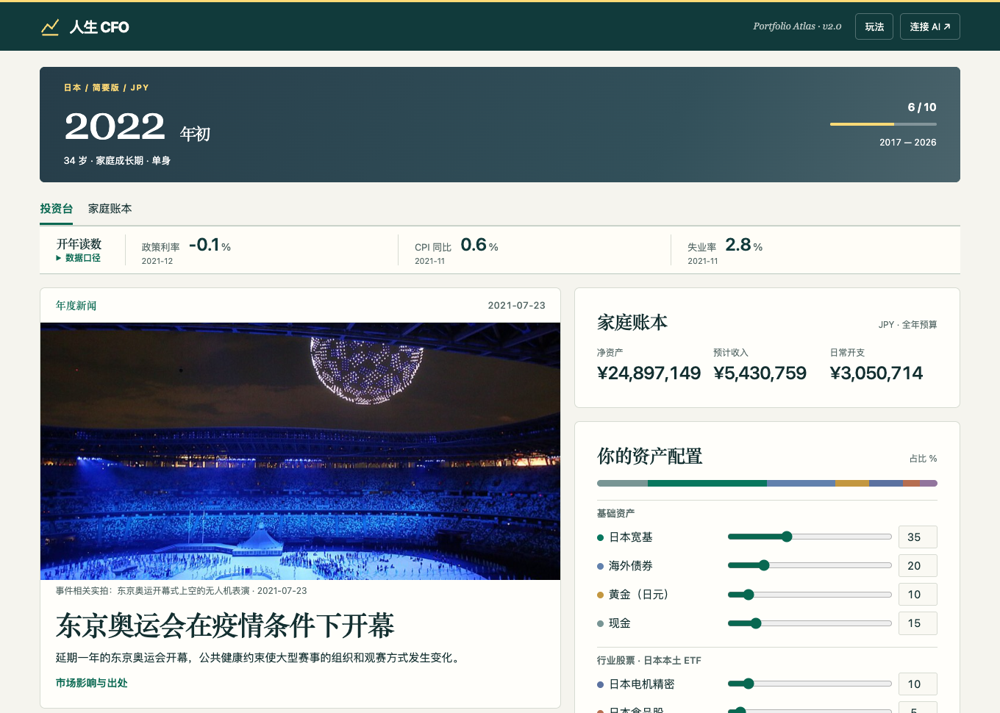

# 人生 CFO · 投资年代记 v2.0

[开始游戏](https://liaojs2025.github.io/life-cfo-game/) · [图文手册](docs/GUIDE.md) · [数据与来源](docs/ATLAS-DATA.md) · [发布记录](docs/RELEASE.md)

翻开上一年的财经新闻，为家庭配置资产。美国使用美元，日本使用日元。两国都有 **2017–2026 简要版** 和 **1987–2026 完整版**。四份旅程分别保存。2026 使用截至 **9 月 30 日** 的实际行情。

每期开年先看利率、CPI 与就业或汇率读数，读一则当时的产业或社会新闻。年末账单配一句收盘锐评和真实资产涨跌。首页「玩家足迹」展示自 v2.0 起的浏览量、完整通关次数及最近的匿名终局。



## 玩法

1. 阅读上一年头条、开年背景和两条市场基准的上年涨跌。
2. 在宽基、债券、黄金、现金及三类行业股票间分配 100%。日本行业股票在 2009 年起使用本国电机精密、食品、医药板块，此前使用按日元折算的海外行业组合。
3. 揭晓实际资产回报与随机家庭事件，核对三方的投资损益、费用、现金流和净资产。
4. 完成旅程或家庭破产时，查看投资者画像、五条投资曲线、年化收益、夏普比率、最大回撤与历史事件图谱。

进取、稳健两位对手与你使用相同的起始资产和家庭现金流。可直接使用规则策略，也可在游戏内连接 DeepSeek、易方达、OpenAI、智谱或 Kimi。模型依据当时已知的宏观信号提交决定。密钥只用于当前页面和当次中继请求。

## 本地运行

本地预览使用 Node.js 22.13 或更高版本。

```sh
git clone https://github.com/liaojs2025/life-cfo-game.git
cd life-cfo-game
npm run dev
```

打开 [本地游戏](http://127.0.0.1:4173)，旧版路径为 `/legacy.html`。

```sh
npm test
npm run check
npm run build:pages
```

静态前端产物为 `output/pages`；运行 `npm ci`、`npm run build` 可打包含中继与共享统计的 Worker，D1 绑定名为 `DB`，迁移文件在 `drizzle/`。部署流程见 [RELEASE](docs/RELEASE.md)。

## 数据与维护

[产品规划](docs/PRODUCT.md) · [模块变更](docs/MODULES.md) · [行情与代理](docs/ATLAS-DATA.md) · [年度新闻与照片](docs/ATLAS-PRESS.md) · [背景提纲](docs/BACKGROUND.md) · [独立审计](docs/ATLAS-AUDIT.md) · [历史数据归档](docs/DATA30.md)

[三十年旧存档](https://liaojs2025.github.io/life-cfo-game/atlas30.html) 与 [港湾城存档](https://liaojs2025.github.io/life-cfo-game/legacy.html) 可在各自原有规则下继续。作者 [liaojs2025](https://github.com/liaojs2025)。
