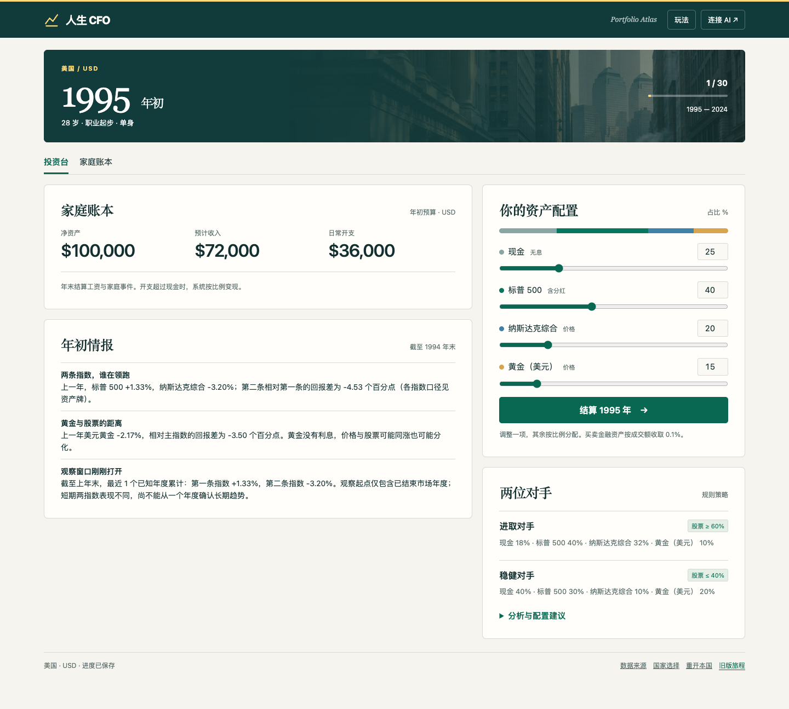
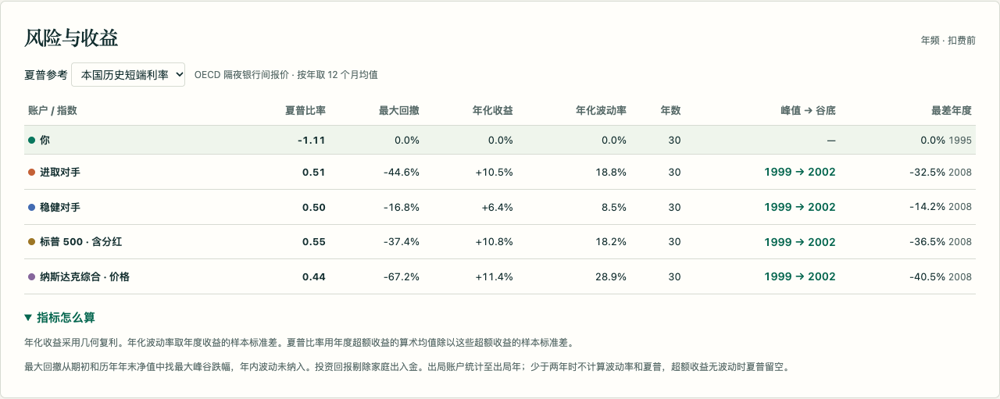
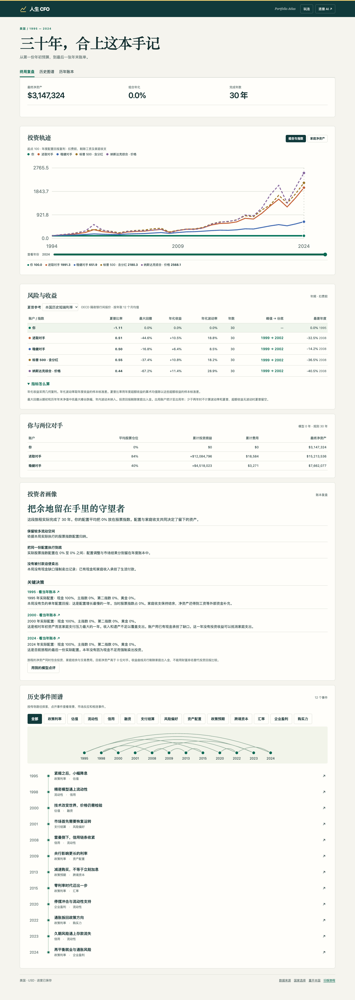
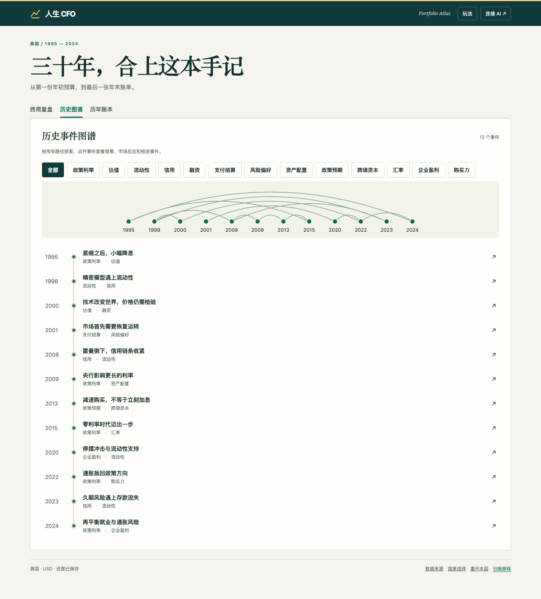

# 三十年投资手记 · 五分钟上手

[游戏入口](https://liaojs2025.github.io/life-cfo-game/) · [数据说明](DATA30.md) · [发布状态](RELEASE.md)

从美国或日本开启一段 1995–2024 年的旅程。你只需每年安排一次投资比例，生活自己往前走：工资、婚育、健康支出与遗产会改变家庭现金流。

## 先完成第一年

1. 选择美国或日本。美国使用美元，初始资产 10 万；日本使用日元，初始资产 1,000 万。每次新局会生成家庭经历，初始年龄为 22–35 岁。
2. 阅读年初情报和家庭预算。此时看不到新一年的市场回报，也不知道尚未发生的个人事件。
3. 调整现金、两条股票指数、黄金四项比例。拖动滑杆或输入整数，其余资产会联动，使合计保持 100%。
4. 查看“两位对手”的分析，愿意时采用建议，再按自己的判断修改。
5. 点击“结算这一年”，揭晓市场和家庭来信，核对账本后进入下一年。

*三十年主玩法实机演示。手册截图不包含密钥；规则路径不代表真实模型调用。*

## 两位对手怎样行动

进取对手把至少 60% 配置到股票指数，稳健对手不超过 40%。双方与你使用相同初始资产、市场和家庭收支，差异来自独立配置及其费用。

不连接模型，规则对手也能完整走完旅程。点击顶部“连接 AI”后，可以选择 DeepSeek、EFUND、OpenAI、GLM 或 Kimi，填写自己的模型与 API Key。每年一次请求同时生成两位对手的决定和给你的建议，成功结果在市场揭晓前封存。

遇到连接或内容校验失败，可以重试，也可以点击“本年用规则策略”。界面会标明来源。请求按服务商用量计费，重试可能重复计费；密钥只在当前页面内存中，刷新后需重新填写。模型参数和额度见 [发布与维护](RELEASE.md)。

## 年末先对账，再评价投资

年度报表可切换“你、进取对手、稳健对手”，查看年初与年末资产、未付负债和净资产。变动条形图把工资、家庭支出、遗产、投资损益和交易费用分开。

生活费基数在结算后按本国历史 CPI 调整供下一年使用；工资基数仍按每年 2.5% 的模拟趋势增长，职业和家庭事件另行影响收入。当年的通胀数值不会提前告诉玩家或 AI。

**年末净资产 = 年初净资产 + 投资损益 + 家庭净流入 − 费用。** 例如，工资结余让资产增加，并不等于配置战胜了市场。

非现金资产买卖每侧计收 0.1% 费用。家庭净支出先用现金支付，仍不足时按比例卖出投资；全部资产用完仍欠款，就保留未付负债并出局。玩家出局会立即结束，对手出局后不会被下一年工资“复活”。

“投资轨迹”有两种视图：

| 视图 | 回答什么问题 |
| --- | --- |
| 组合与指数 | 同以 100 起步，比较扣费前年度配置回报复利，剔除家庭出入金。 |
| 家庭净资产 | 用美元或日元显示实际资产减负债，包含家庭收支和费用。 |

点击图例可显示或隐藏曲线，用年份滑块查看某一年。美国标普采用含分红回报，其他股票指数为价格回报，不能忽略这一差别；资产说明写明了各自口径。

## 终局的风险与收益表

表格使用五条序列：你、进取对手、稳健对手和两条本国股票指数。每个已完成年份只有一个回报样本，剔除家庭收支，采用扣费前口径。

| 指标 | 计算与阅读方法 |
| --- | --- |
| 年化收益 | 将各年回报几何复利后，折算为每年的复合增长率。 |
| 年化波动率 | 年度回报的样本标准差，分母为样本数减一；因为已经是年频，不再乘日频换算因子。 |
| 夏普比率 | 每年先减去同年的参考利率，再用这些超额回报的算术均值除以其样本标准差。 |
| 最大回撤 | 从期初及历年年末净值找最大的峰到谷跌幅，并列出峰值、谷底年份；不包含年内更深的跌落。 |
| 最差年度 | 已完成样本中最低的单年回报及年份。 |

夏普的事后计算口径可参阅 [William F. Sharpe 的原文](https://web.stanford.edu/~wfsharpe/art/sr/SR.htm)。

夏普默认使用“历史隔夜利率近似（OECD）”，也可选择游戏无息现金 0% 或自定义固定年利率。历史参考把本国全年十二个月的隔夜银行间报价取算术平均，仍是利率近似，不是居民可以无风险买到的真实现金复利。来源与聚合方法见 [DATA30](DATA30.md)。点击最大回撤的峰谷年份，可跳到曲线的谷底年份查看当时表现。

切换参考只改变分析，不改历史配置、现金收益或家庭账本。少于两年不计算波动率和夏普；超额回报完全没有波动时，夏普留空。出局对手只统计到出局年，比较前先看表中的样本年数。历史参考利率只用于已完成年份的复盘，不提前进入年度决策。

## 提前结束也能复盘

完成三十年或净资产耗尽后，都能查看投资者画像。规则复盘会选出实际回报较弱、配置调整较大和现金流较紧的年份，解释配置、家庭事件和结果之间的关系。接入模型后，还可获得基于同一份真实记录的模型复盘。

画像证据绑定已执行的配置；只有一年经历时就引用这一年，不补造选择。它描述本局行为，不给现实心理诊断，也不承诺以后能赚多少。

若一条模型点评包含无法核验的收益数字，程序可以仅将该条替换为标注“账本点评”的事实说明，保留其余有效画像；刷新时仍逐条核对，不展示未经核验的原数值。

## 沿着历史图谱继续读

“历史图谱”将已解锁的宏观事件按年份和主题组织。点击事件节点，阅读事件背景、关联主题、传导关系和资料来源，再对照自己的投资曲线。

事件关系是教育性解释，不表示某件新闻单独导致某个精确年度回报；未完成年份的事件不会提前解锁。

## 进度保存与旧版

美国和日本分别自动保存，可以回到国家选择页继续另一段旅程。刷新会重放核对账本和封存决定；同一浏览器不同站点的存档不互通。不要在需要保留进度时清除站点数据。

“重开本国”会先确认，再替换该国进度并生成新的家庭种子。当前新玩法没有文件导入、导出或跨设备同步。

原港湾城二十年保留在 [旧版入口](https://liaojs2025.github.io/life-cfo-game/legacy.html)，使用独立旧存档。房车、保险、生活选择、心情与旧版挑战不属于本次三十年主玩法。

作者：[liaojs2025](https://github.com/liaojs2025)
