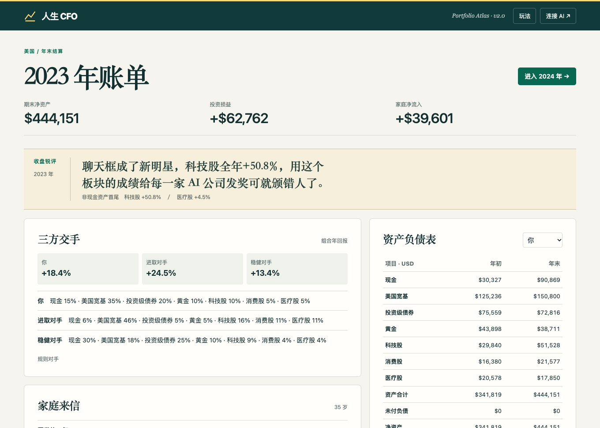
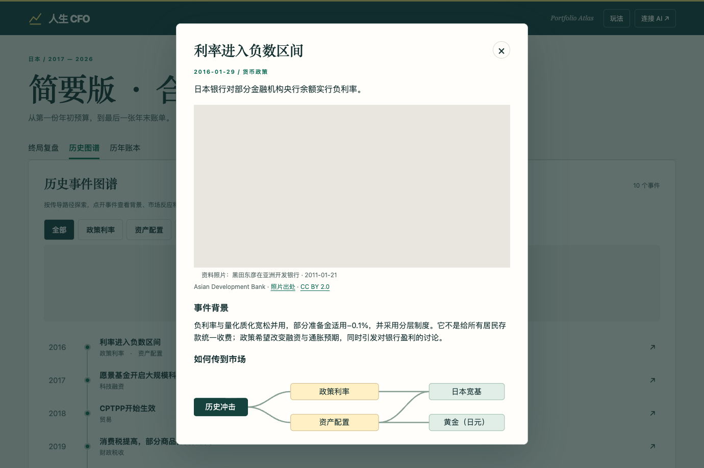
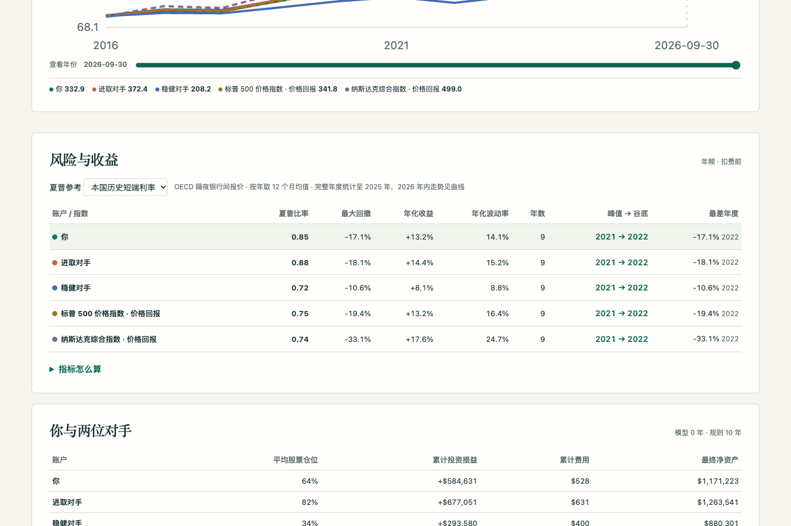

# 投资年代记 v2.0 · 游戏手册

[打开游戏](https://liaojs2025.github.io/life-cfo-game/) · [行情口径](ATLAS-DATA.md) · [新闻及照片出处](ATLAS-PRESS.md)

先选简要版（2017–2026）或完整版（1987–2026），再选美国或日本。初始资金分别为 10 万美元和 1,000 万日元。四条路线独立存档，关闭网页后可在同一浏览器继续。

## 年初做一次配置

先扫一眼「开年读数」的利率、CPI 同比和失业率，每个读数下面是对应的观测时间。日本 1987–2003 年开局用美元兑日元补足第三项，十月失业率的历史汇编值留在年末回看。打开「数据口径」可看利率类型、指标来源和数据版本。左侧新闻卡回顾上一年。图片下写有拍摄日期，点击「市场影响与出处」可查看史料与照片版权。「时代侧记」从生活与产业切入，补上当时的背景；相邻的简报列出政策和两个市场基准的上年涨跌。

右侧先看家庭预算，再在现金、宽基、债券、黄金和三个行业股票之间分配资金。拖动滑杆或输入整数，其余仓位会按比例调整，使合计保持 100%。美国行业为科技、消费和医疗。日本从 2009 年起使用电机精密、食品和医药的本国 ETF，早期完整路线使用按日元换算的海外行业组合。若持有旧行业组合跨过 2008 年末，账本会列出卖出旧组合并买入本土基金的换仓费。点页脚「数据来源」可查看各资产的实际代理、币种与分红口径。

进取对手股票仓位至少 60%，稳健对手至多 40%。展开分析可以查看理由或采用建议。游戏内的规则对手随时可用，也可以在顶部「连接 AI」填写服务、模型与自己的密钥。真实模型按服务商用量计费。刷新后已封存的决定继续生效，开启下一次调用需要重新输入密钥。

## 结算时看两本账

「收盘锐评」用一句话记下本期行情。旁边的非现金资产首尾读数都来自本国账本，可用它们核对玩笑里说的到底是哪一段涨跌。

**投资成绩**看配置回报。三位玩家的投资曲线都从 100 开始，与两条本国指数同图比较，口径为家庭费用和外部现金流之前的复利。指数只出现在市场背景与比较视图。

**家庭账本**核对期末净资产。期初净资产加投资损益、加工资与其他家庭净流入、减交易费用，得到期末净资产。婚育、职业变化、健康支出和遗产按照年龄与家庭阶段自动发生。若现金不足，系统按比例卖出投资支付账单。玩家净资产耗尽时进入终局。

2026 年的最后一期截至 9 月 30 日。行情使用该日的年内累计回报，经常收入和开支按实际覆盖天数结算，一次性家庭事件按发生日入账。

## 玩家足迹

每次重新打开或刷新游戏记一次浏览，浏览器内切换路线不另计。简版走完十期、完整版走完四十期，均计一次完整通关。破产结局可出现在匿名成绩中，单独标明提前破产。服务器按实际配仓重新结算，同一局反复查看只记一次。联网恢复后会重试尚未送达的成绩。

## 终局复盘

沿曲线选年份，查看当年的玩家、两位对手和市场基准。切换到家庭净资产可以看到工资、支出及费用怎样改变结果。读完画像中的关键年份，再到「历史图谱」挑选事件，打开背景、传导机制、当年市场结果和原始资料。

| 指标 | 怎么读 |
| --- | --- |
| 年化收益 | 各完整年度回报连乘，再折合成每年复合增长率。 |
| 波动率 | 完整年度回报的样本标准差。 |
| 夏普比率 | 年度超额回报均值除以其样本标准差。可选本国历史隔夜利率、无息现金或自定参考利率。 |
| 最大回撤 | 从期初与完整年末净值中找最大的峰谷跌幅，表内可查看峰谷年份。 |
| 最差年度 | 实际观测中回报最低的完整年度。 |

2026 年内结果进入净资产和投资曲线。终局年频表使用完整年份，所以通关简要版是九个年频样本，完整版是三十九个；提前出局的账户按实际观测计算。表中「—」表示样本不足或比率无法定义。

