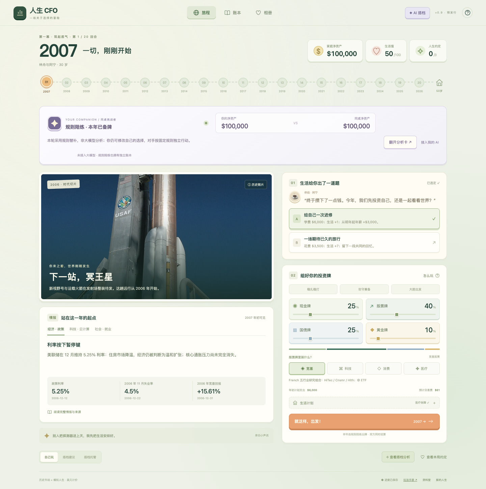
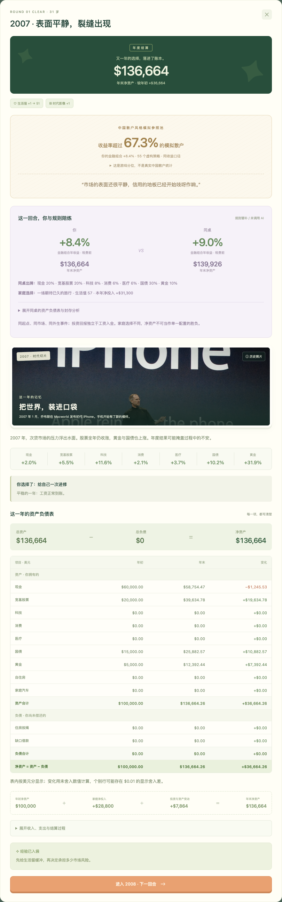
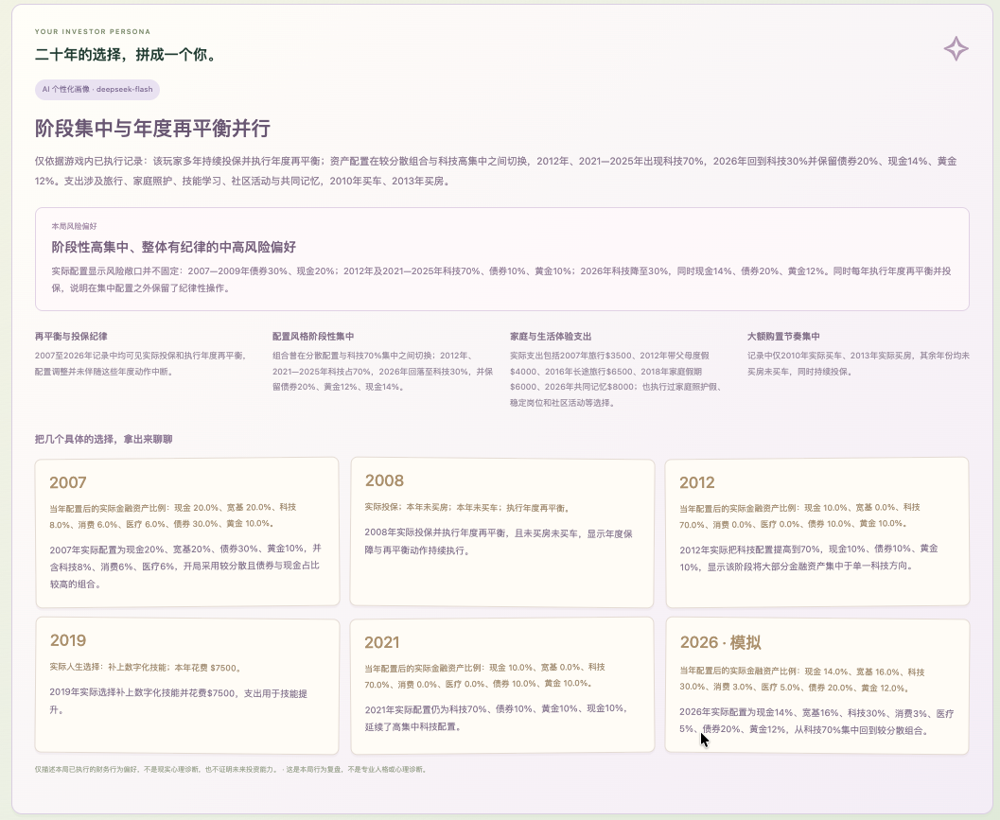

# 人生 CFO：五分钟上手手册

[打开游戏](https://liaojs2025.github.io/life-cfo-game/)

你从 30 岁、10 万美元净资产出发，陪伴林舟与阿宁走过二十次年度选择。每年既要安排投资，也要面对家庭、住房、保障与生活取舍；到 50 岁，回看自己怎样走到了这里。

三个挑战是：**二十年无缺口借款、净资产达到 100 万美元、生活满意度达到 75 且没有未偿还的缺口借款**。住房按揭不算缺口借款；未完成全部挑战也可以走完旅程。

## 先玩完你的第一年

1. **读情报**：切换年初资讯标签，看看政策、行业与社会变化；点击“阅读完整情报与来源”可看更多背景。
2. **选生活**：在“生活给你出了一道题”中选择一张事件卡，留意它对花费、收入和生活值的影响。
3. **组投资牌**：分配现金、股票、国债、黄金，再选择股票方向。首次也可以从“稳扎稳打”“攻守兼备”“大胆出发”中选一组再调整。
4. **看生活计划**：决定是否续保、买房、买车，以及是否“每年重新配牌”。确认年初支出和交易费。
5. **点击“就这样，出发！”**：双方同时结算，揭晓这一年的市场与家庭事件。读完年度复盘，再进入下一年。

不接入 AI 也能完整游玩，规则陪练会拥有自己的账户。若按钮暂时不可用，先检查是否选择了生活事件卡、预算是否合法，以及搭档是否完成本年决定。

*主界面与下方年度复盘均为当前版本的规则陪练示例，无需配置 API 即可体验。*

## 三种模式，按你的节奏来

| 模式 | 你怎样参与 |
| --- | --- |
| **自己玩** | 自己选择生活方案和配置，也可以翻看搭档分析。 |
| **搭档建议** | 先看建议，点击采纳后仍可修改，最后由你确认。 |
| **搭档托管** | 执行针对你账户生成的方案；仍需手动点击“让搭档出牌”推进一年。 |

托管时家庭和配置选项会锁定。想亲自调整，切回“自己玩”或“搭档建议”。模式切换不会重抽已经封存的 AI 决定。

## 四张牌，七类金融资产

拖动任意一张主牌，其他比例会自动调整，总计保持 100%。股票牌里可以选择一个方向；点击新方向，会把**全部股票比例**转到该方向。

| 主牌 | 实际持有的资产 | 读牌时留意 |
| --- | --- | --- |
| 现金 | 现金 | 方便支付家庭开支；游戏采用明确的模拟收益。 |
| 股票 | 宽基、科技、消费、医疗 | 四个方向各有收益，也可能互相重叠；集中一个行业会放大行业影响。 |
| 国债 | 美国国债 | 价格也会波动，并非每年稳赚。 |
| 黄金 | 黄金 | 与其他资产表现可能不同，也会下跌。 |

搭档的建议可能同时配置几个股票方向，界面会显示“混合板块”；采纳后可以保留，也可以点击某一方向改为集中持有。

“生活计划”中关闭“每年重新配牌”，就是**维持持仓**：目标比例不再执行，家庭开支仍需支付。游戏不强制留现金；年末现金不足会先卖出金融资产，仍不够才产生缺口借款。房车有后续维护成本，当前版本买入后不能卖出。

年初情报只展示该决策时点可知的内容；当年行情与事件在结算后揭晓。它们是判断材料，没有保证获胜的标准答案。

## AI 是建议者，也是独立的同桌

公开站点的 AI 连接仍可能失败，可先用规则陪练完整体验；当前验收状态见 [发布记录](RELEASE.md)。

点击“AI 搭档”或“接入我的 AI”。当前版本使用 **EFUND**，默认模型为 **gpt-4o**：

- 服务地址可填 `https://aigc.efunds.com.cn/v1`，也可保留预填的完整地址。
- 填入你自己账号的 API Key；如需更换模型，使用该账号已开通的模型名称。
- 点击“连接并启用 AI”。服务商可能收费；重试也可能重复计费。

密钥只保留在当前页面内存，由游戏中继临时转交，不写入存档或导出文件；刷新后需重新填写。

每年一份成功回答包含公开信息分析、给你的建议，以及同桌自己的决定。打开“翻开分析卡”可核对它引用的情报、推理与风险。AI 使用的是玩家也能查看的匿名情报摘要，不读取未来行情；这仍不能保证推理正确，也不能彻底排除模型对历史的记忆。

同桌有独立的投资、家庭选择和账本。它的决定在揭晓前封存，刷新或换模式不能重抽。你可以修改给自己的建议；更改模型只影响后续尚未封存的回合。若请求失败，可按提示重试，或明确选择“本年用规则陪练”，页面会标明实际来源。

## 年度复盘：先看钱从哪里来

每次结算后，先看年末净资产和生活值，再查看双方的税费前金融组合回报、家庭选择和完整账本。顶部回合地图可重看已完成年份，“账本”可逐年核对。

**净资产 = 总资产 − 总负债。** 表内有七类金融资产、自住房、汽车，以及住房按揭、缺口借款；每项列出年初、年末与变化。

读表时记住三个区别：

- **资产余额增加不全是投资收益。** 工资结余、买卖、购房和还贷都可能改变余额。
- **金融组合回报与家庭净资产分开看。** 工资和生活选择不同，即使市场相同，双方最后的钱也会不同。
- **还贷本金与利息不同。** 本金减少现金，也减少负债；利息才是当年的支出。

复盘里的等式会帮助核账：**年初净资产 + 家庭净投入 + 投资与资产变动 = 年末净资产**。展开“收入、支出与结算过程”，可以查医疗赔付、维护费、交易费用和被动卖出的原因。

## 二十年后，看见你的选择方式

完成最后一轮后，你会得到结局、财富曲线、目标进度，以及个人行为画像。画像关注的是这局游戏中的风险偏好、家庭取舍与变化，并引用至少三个不同回合的实际选择作为证据。

已连接模型时可以生成 **AI 个性化画像**；未连接时可先看规则复盘，再点击“连接 AI，生成我的画像”。规则画像与模型画像会分别标识，不会混为一谈。

*这是玩家提供的画像示例。你的标题、分析和证据取决于自己的旅程；它是游戏行为复盘，不是专业人格或心理诊断。*

## 保存进度与几个边界

进度会自动保存在当前浏览器、当前站点；页脚显示保存状态。刷新后可继续，已封存结果保留。更换设备、换站点或清理浏览器数据不会自动迁移进度。

点击“新的人生”前，可以先“导出当前旅程”保存账本与决策记录。**目前导出用于留档，没有文件导入功能**；开始新局会替换当前旅程，旧版本封存记录保留。

游戏使用美元计价：2007–2025 为历史行情，**2026 是架空模拟终章**。家庭、保险、住房、汽车和现金收益含教学假设；板块数据的具体口径可在“资料室”查看。“超过多少模拟策略”来自虚构参照池，不是真实中国散户排名。重玩会标记为已知剧情，历史回放成绩也不等于预测能力。

打开“相册”，把这些年份的照片、图解和你的选择一起留下来。
